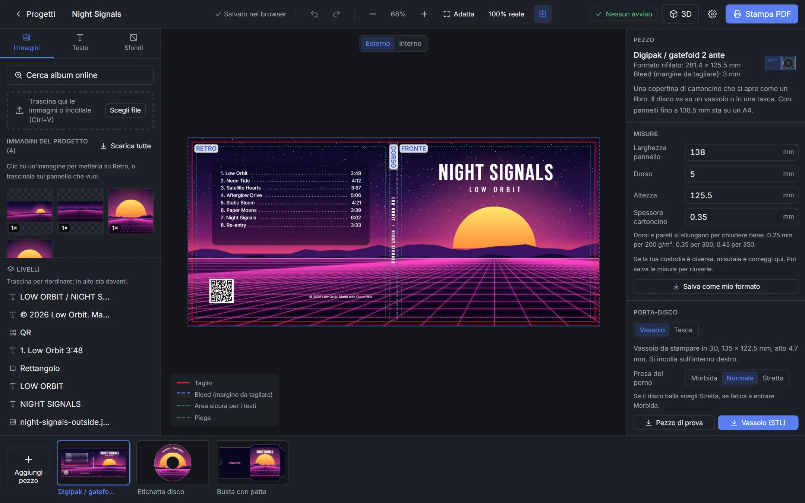
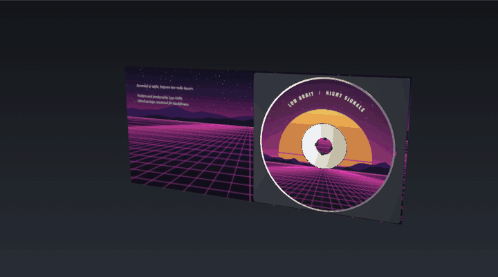
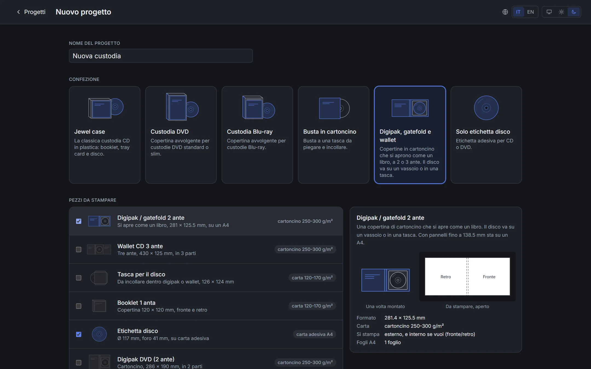
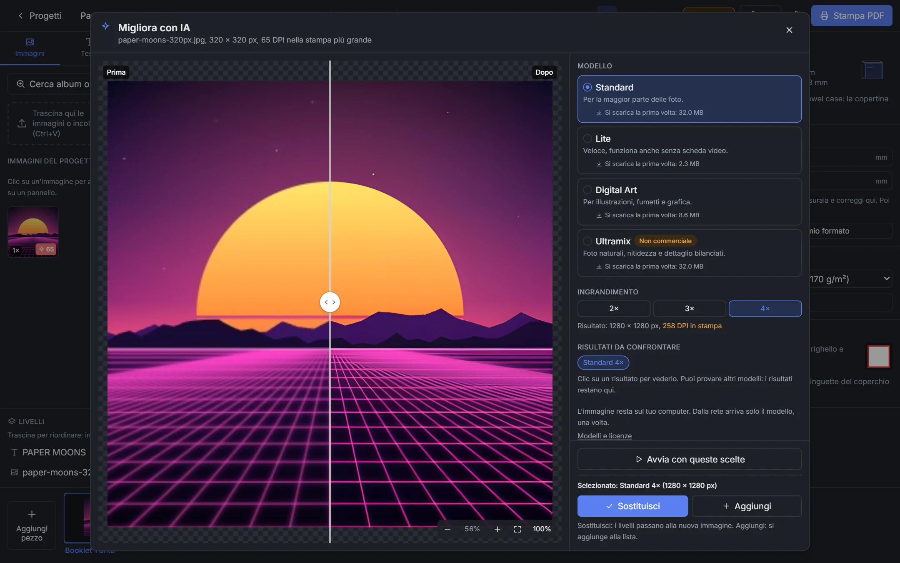
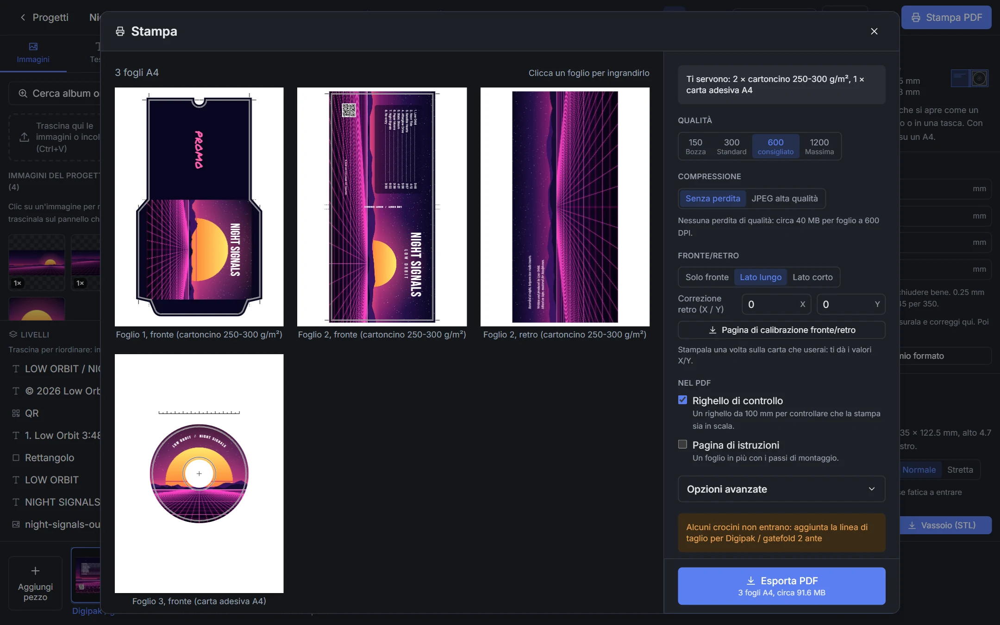
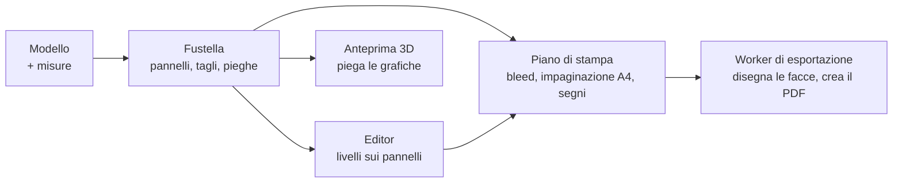

<div align="center">


# Coverfold

**Crea le custodie per CD, DVD e Blu-ray nel browser.<br>Stampi su A4, tagli, pieghi, fatto.**

<a href="https://r0adrunn3r.github.io/coverfold/"></a>

<a href="https://github.com/R0adRunn3r/coverfold/actions/workflows/pages.yml"></a>
<a href="LICENSE.md"></a>


<a href="https://ko-fi.com/r0adrunn3r"></a>

[Funzioni](#funzioni) | [Formati](#formati) | [Come iniziare](#come-iniziare) | [Consigli di stampa](#consigli-di-stampa) | [Come funziona](#come-funziona)

<sub>[English](README.md) | Italiano</sub>

</div>



Coverfold serve a creare le confezioni stampate per i tuoi dischi: booklet e tray card per jewel case, copertine per DVD e Blu-ray, buste in cartoncino, digipak, wallet, slipcover ed etichette per il disco. Trascini le immagini sui pannelli, aggiungi i testi ed esporti un PDF che si stampa in scala reale su A4, con bleed, crocini, linee di piega e istruzioni di montaggio.

Funziona tutto nel browser. Niente account e niente upload: le immagini restano sul tuo computer e, dopo la prima visita, l'app funziona anche offline.

**Long live physical media.** Coverfold è per la musica che tieni sullo scaffale: una compilation masterizzata, il demo di una band, un disco che ha perso la copertina.

## Guardala piegarsi

<div align="center">

</div>

L'anteprima 3D piega le tue grafiche dal foglio stampato alla custodia finita. Digipak e wallet mostrano il disco sul suo vassoio o nella sua tasca.

## Funzioni

### Confezioni

- **19 modelli** per jewel case, custodie DVD e Blu-ray, buste, digipak, wallet ed etichette ([elenco completo](#formati)).
- **Ogni fustella è generata dalle misure.** Larghezza dei pannelli, dorso, altezza, alette e spessore del cartoncino sono parametri: adatti il modello a una custodia vera al decimo di millimetro e salvi il risultato come formato tuo.
- **Conta lo spessore del cartoncino:** dorsi e pareti crescono di quanto serve per chiudere bene.
- **Più grande dell'A4?** Il pezzo viene diviso lungo una piega in parti con linguette da incollare, segnate con una lettera (A, B...). Le istruzioni spiegano come unirle.
- **Porta-disco per digipak e wallet:** un vassoio da [stampare in 3D](#vassoio-stampato-in-3d) oppure una tasca di carta della misura del pannello.



### Vassoio stampato in 3D

Non hai un vassoio di plastica? Per digipak e wallet Coverfold genera un **file STL su misura**: un vassoio grande quanto il pannello su cui si incolla, con un perno a quattro bracci a molla che aggancia il disco con un clic e due incavi per sollevarlo con il dito.

- La presa ha tre livelli, morbida, normale e stretta, perché ogni stampante è un po' diversa.
- Un **pezzo di prova**, un disco da 44 mm con il solo perno, si stampa in pochi minuti per provare la presa prima di stampare tutto il vassoio.
- Si stampa in PLA o PETG con strati da 0.2 mm, senza supporti, con la faccia piana sul piatto. Si incolla con biadesivo forte, senza colla sotto i bracci.
- L'anteprima 3D mostra vassoio e disco dentro la custodia, e l'app avvisa se il dorso è troppo sottile per chiudersi sopra.

Preferisci la carta? Scegli la tasca: Coverfold aggiunge una tasca per il disco della misura del pannello.

### Editor

- Trascini un'immagine su un pannello e lo riempie, bleed compreso, senza deformarsi. Per spostarla su un altro pannello basta trascinarla lì.
- Ritaglio con le maniglie o a proporzioni fisse, forma tonda o con angoli arrotondati, luminosità, contrasto, saturazione e sfocatura.
- Testi pensati per le copertine: tracklist con le durate allineate a destra e i puntini, testo del dorso già ruotato e centrato, testo curvo sull'etichetta del disco. Nel PDF il testo resta testo vero, vettoriale.
- Sfondi in tinta unita o sfumati con i colori presi dalle tue immagini, forme, ombre, contorni, fusioni (Moltiplica per i loghi scansionati) e contagocce.
- Codici QR, anche con un logo al centro, e la verifica che il telefono riesca ancora a leggerli.
- Allineamento al pannello, al pezzo o tra i livelli selezionati. Livelli, blocco, annulla e ripeti.
- Booklet a punto metallico da 8 a 32 pagine, modificati pagina per pagina. L'ordine delle pagine sui fogli lo calcola l'app.
- Controlli prima della stampa: risoluzione bassa, testo fuori dall'area sicura o sopra una piega, QR che non si leggono.

### Ricerca dell'album

Cerchi su MusicBrainz, scegli l'edizione e metti dove vuoi le sue copertine, prese dal Cover Art Archive, e la sua tracklist, anche su pezzi diversi del progetto. Un solo annulla toglie tutto l'import.

### Ingrandimento con IA

Un'immagine piccola si ingrandisce 2×, 3× o 4× con quattro modelli di IA (Standard, Lite, Digital Art, Ultramix), sulla tua scheda video tramite WebGPU. Confronti prima e dopo con un divisore e lo zoom al 100%, provi un altro modello, poi sostituisci l'originale o li tieni tutti e due. L'ingrandimento si ferma a 1200 DPI, oltre i quali la stampa non migliora.



### Stampa

- PDF A4 in scala reale, da 150 a 1200 DPI (consigliati 600), senza perdita o in JPEG di alta qualità.
- Crocini, tacche di piega e linea di taglio dove i crocini non entrano. Bleed da 0 a 5 mm.
- Stampa fronte/retro con la correzione del retro e una pagina di calibrazione per trovarla.
- Un righello di controllo da 100 mm in uno spazio libero del foglio e, se vuoi, una pagina con i passi di montaggio illustrati.
- La finestra di stampa mostra ogni foglio e ti dice quale carta caricare.



### Tutti i giorni

- Si installa come un programma: si apre dalla sua icona e funziona offline. I modelli IA si scaricano al primo uso (da 2 a 33 MB) e restano in memoria.
- I progetti si salvano da soli nel browser. Con il backup `.coverfold`, immagini comprese, ne tieni una copia o li porti su un altro computer.
- Italiano e inglese, tema chiaro e scuro. La carta resta bianca, come in stampa.

## Formati

Le misure sono quelle del formato rifilato con i valori predefiniti; si possono regolare tutte.

| Confezione | Pezzo | Misure (mm) | Carta |
|---|---|---|---|
| Jewel case | Booklet 1 anta | 120 × 120 | carta |
| | Booklet 4 facciate | 240 × 120 | carta |
| | Booklet multipagina a punto metallico | da 8 a 32 pagine di 120 × 120 | carta |
| | Tray card, due dorsi da 6.5 mm | 151 × 118 | carta |
| | Obi | 71 × 120 | carta |
| | O-card | 142.5 × 281.4 | cartoncino |
| Disco | Etichetta: adesiva (foro 41 mm), a tutta superficie (22 mm), mini CD | Ø 117 | carta adesiva |
| DVD | Copertina: dorso standard da 14 mm, slim da 9 e 7 mm | 273 × 183 | carta |
| | Digipak 2 ante | 286.4 × 190, in 2 parti | cartoncino |
| | Slipcover | 313.4 × 191, in 2 parti | cartoncino |
| Blu-ray | Copertina: dorso standard da 11 mm, Elite 12.5 mm, slim 7 mm | 269 × 148 | carta |
| | Slipcover | 297.4 × 149.5, in 2 parti | cartoncino |
| Busta | Busta in cartoncino | 248 × 151 | cartoncino |
| | Busta con patta: linguetta nella fessura o patta infilata | 281 × 151 oppure 266 × 151 | cartoncino |
| | Busta interna in carta | 248 × 151 | carta |
| | Cofanetto per busta | 259.1 × 155.7 | cartoncino |
| Digipak | Digipak o gatefold 2 ante, con vassoio o tasca | 281.4 × 125.5, su un A4 | cartoncino |
| | Wallet CD 3 ante | 428.7 × 125, in 3 parti | cartoncino |
| | Tasca per il disco | 138 × 148 | carta |

## Come iniziare

### Online

Apri **https://r0adrunn3r.github.io/coverfold/**. Il risultato migliore è con Chrome o Edge: l'ingrandimento con IA richiede WebGPU e, senza, funziona solo il modello Lite, sul processore.

### Sul tuo computer

Serve [Node.js](https://nodejs.org/) 20.19 o successivo (consigliati 22 o 24).

```bash
npm install
```

```bash
npm run dev
```

Poi apri http://localhost:5173.

Il browser tiene i progetti separati per indirizzo: quelli creati su `localhost` non si vedono sul sito. Per spostarli usa il file di backup.

## Consigli di stampa

- Nella finestra di stampa scegli **Dimensioni effettive** o **100%**, mai "Adatta alla pagina".
- Misura il righello di controllo sul foglio: deve essere esattamente **100 mm**.
- Usa carta da 120 a 170 g/m² per booklet e tray card (va benissimo la fotografica opaca), cartoncino da 250 a 300 g/m² per buste, digipak e cofanetti, carta adesiva A4 per le etichette dei dischi.
- Stampi in fronte/retro? Stampa una volta la pagina di calibrazione sulla carta che userai, guardala in controluce e inserisci i valori X/Y che indica.
- Prima di piegare, segna le pieghe con una punta smussata e un righello: la piega viene dritta e la stampa non si crepa.

<details>
<summary><b>Scorciatoie da tastiera</b></summary>

| Tasti | Azione |
|---|---|
| <kbd>←</kbd> <kbd>→</kbd> <kbd>↑</kbd> <kbd>↓</kbd> | Sposta di 0.5 mm, con <kbd>Maiusc</kbd> 5 mm |
| <kbd>Ctrl</kbd> <kbd>Z</kbd> / <kbd>Ctrl</kbd> <kbd>Y</kbd> | Annulla / ripeti |
| <kbd>Ctrl</kbd> <kbd>D</kbd> | Duplica |
| <kbd>Canc</kbd> | Elimina |
| <kbd>Ctrl</kbd> <kbd>]</kbd> / <kbd>Ctrl</kbd> <kbd>[</kbd> | Porta avanti / indietro, con <kbd>Maiusc</kbd> in cima / in fondo |
| <kbd>Ctrl</kbd> + rotella, <kbd>Ctrl</kbd> <kbd>+</kbd> <kbd>-</kbd> <kbd>0</kbd> | Zoom, adatta |
| <kbd>Spazio</kbd> + trascina, rotella | Sposta la vista |
| <kbd>Ctrl</kbd> <kbd>V</kbd> | Incolla un'immagine dagli appunti |

</details>

## Come funziona

I modelli sono codice, non disegni. Ognuno trasforma le sue misure in una fustella (pannelli, contorno di taglio, pieghe, zone di colla, fessure) e tutto il resto deriva da lì: le guide nell'editor, la forma del bleed, il modello 3D, la divisione in parti e l'impaginazione sull'A4.



Disegno, esportazione del PDF e ingrandimento con IA girano in Web Worker, così l'editor resta reattivo. I modelli IA sono reti ncnn, convertite in ONNX nel browser ed eseguite con onnxruntime-web. Le immagini vengono elaborate a tessere, così anche quelle grandi stanno in memoria.

**Tecnologie:** TypeScript, React 19 (solo interfaccia), Konva (canvas dell'editor), three.js (3D), pdf-lib (PDF), onnxruntime-web (IA), Dexie (IndexedDB), Comlink (worker), Tailwind CSS, Vite e Vitest.

```
src/
  core/    TypeScript puro: modelli, geometria, bleed, impaginazione A4, piano di
           stampa, composizione del PDF, store dell'editor con annulla, controlli
  engine/  codice per il browser senza framework: canvas dell'editor, worker di
           disegno ed esportazione, archivio, immagini, font, 3D, IA (ai/)
  ui/      schermate e pannelli React
  i18n/    en.json, it.json
```

React si può importare solo in `src/ui` e una regola di ESLint lo fa rispettare: core ed engine non dipendono dal framework dell'interfaccia.

```bash
npm test         # test unitari (Vitest)
npm run lint     # ESLint
npm run build    # controllo dei tipi e build statica in dist/
```

Il workflow in [.github/workflows/pages.yml](.github/workflows/pages.yml) esegue i test e pubblica la build su GitHub Pages a ogni push su `main`. Per una build servita da un sottopercorso si imposta `BASE_PATH` (per esempio `/coverfold/`).

## Crediti

- **Modelli IA:** Standard, Lite e Digital Art sono reti [Real-ESRGAN](https://github.com/xinntao/Real-ESRGAN) di Xintao Wang e Tencent ARC (BSD-3-Clause). Ultramix Balanced è di [Kim2091](https://huggingface.co/Kim2091/UltraSharp) (CC BY-NC-SA 4.0, solo uso non commerciale). Origine e licenza di ogni file in [public/models/README.md](public/models/README.md).
- **Dati degli album:** [MusicBrainz](https://musicbrainz.org/) e [Cover Art Archive](https://coverartarchive.org/). Le copertine appartengono ai rispettivi titolari.
- **Font:** Inter, Oswald, Bebas Neue, Playfair Display, Permanent Marker e Roboto Mono, con licenza SIL Open Font License, tramite [Fontsource](https://fontsource.org/).
- **Librerie:** onnxruntime-web, three.js, Konva, pdf-lib, fontkit, fflate, i18next, zustand, qrcode-generator (MIT); Dexie e Comlink (Apache-2.0).
- Le dime di Pirates Press sono servite solo come riferimento per le misure: tutta la geometria è generata dal codice.

## Contribuire

Hai trovato un bug o hai un'idea? [Apri una issue](https://github.com/R0adRunn3r/coverfold/issues/new/choose): c'è un breve modulo per ciascuno e puoi scrivere in italiano. Anche le pull request sono benvenute. Prima leggi [CONTRIBUTING.md](CONTRIBUTING.md), in inglese: spiega come eseguire i controlli e le condizioni per i contributi. Le novità di ogni versione sono in [CHANGELOG.md](CHANGELOG.md).

## Licenza

Coverfold è libero per l'uso personale e per ogni uso non commerciale, con la [PolyForm Noncommercial License 1.0.0](LICENSE.md): puoi usarlo, studiarlo, modificarlo e condividerlo, ma non per scopi commerciali. Per un uso commerciale apri una issue per metterti in contatto.

I file dei modelli IA in `public/models` non sono coperti da questa licenza e hanno le proprie, elencate in [public/models/README.md](public/models/README.md). Anche Ultramix è solo per uso non commerciale.
