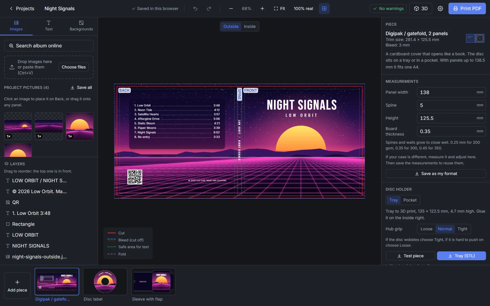
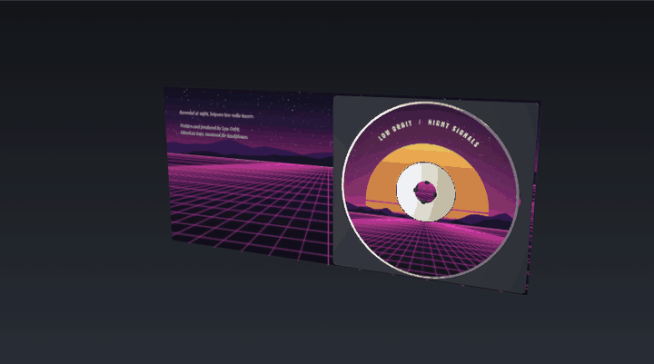
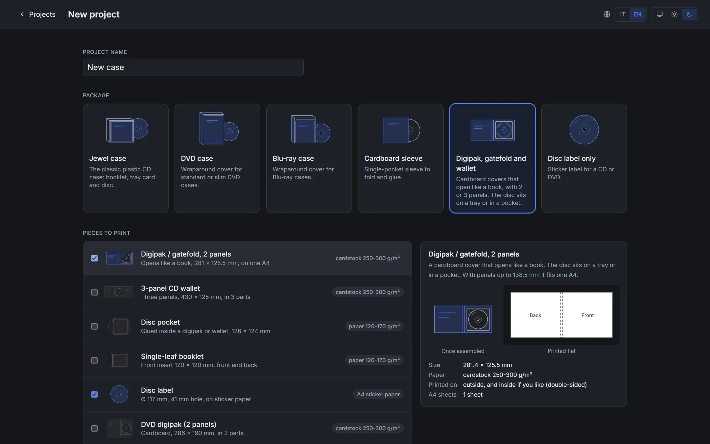
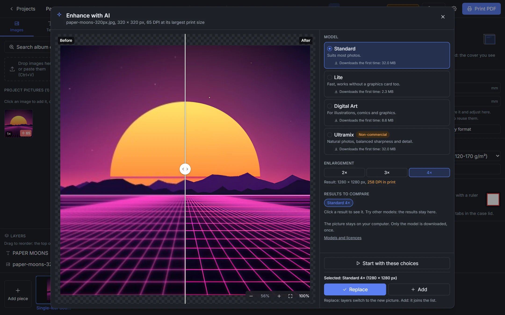
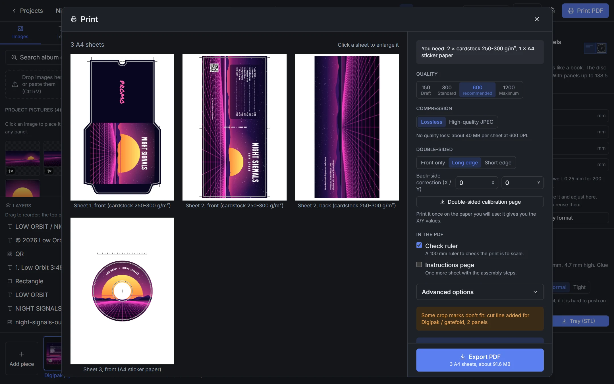
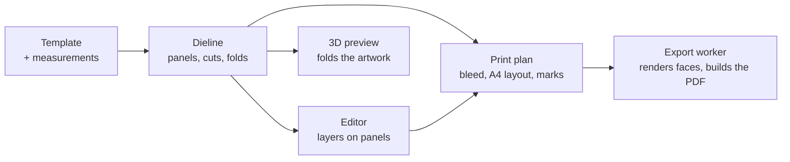

<div align="center">


# Coverfold

**Design CD, DVD and Blu-ray packaging in your browser.<br>Print it on A4, cut, fold, done.**

<a href="https://r0adrunn3r.github.io/coverfold/"></a>

<a href="https://github.com/R0adRunn3r/coverfold/actions/workflows/pages.yml"></a>
<a href="LICENSE.md"></a>


<a href="https://ko-fi.com/r0adrunn3r"></a>

[Features](#features) | [Formats](#formats) | [Getting started](#getting-started) | [Printing tips](#printing-tips) | [How it works](#how-it-works)

<sub>English | [Italiano](README.it.md)</sub>

</div>



Coverfold makes printed packaging for your discs: jewel case booklets and tray cards, DVD and Blu-ray covers, cardboard sleeves, digipaks, wallets, slipcovers and disc labels. Drop your images on the panels, add your text, and export a PDF that prints at exact size on A4, with bleed, crop marks, fold lines and assembly instructions.

Everything runs in the browser. There is no account and no upload: your pictures stay on your computer, and after the first visit the app works offline too.

**Long live physical media.** Coverfold is for the music you keep on a shelf: a burned mixtape, a band demo, a record that lost its artwork.

## See it fold

<div align="center">

</div>

The 3D preview folds your artwork from the printed sheet to the finished case. Digipaks and wallets show the disc on its tray or in its pocket.

## Features

### Packaging

- **19 templates** for jewel cases, DVD and Blu-ray cases, sleeves, digipaks, wallets and labels ([full list](#formats)).
- **Every dieline is generated from measurements.** Panel width, spine, height, flaps and board thickness are parameters, so you can match a real case to a tenth of a millimetre and save the result as your own format.
- **Board thickness is accounted for:** spines and walls grow by what the board needs to close flat.
- **Larger than A4?** The piece is split along a fold into parts with lettered glue tabs (A, B...). The instructions explain how to join them.
- **Disc holders for digipaks and wallets:** a tray you [3D print](#3d-printed-disc-tray), or a paper pocket sized to the panel.



### 3D-printed disc tray

No plastic tray at hand? For digipaks and wallets Coverfold generates an **STL file made to measure**: a tray sized to the panel it is glued on, with a hub of four spring arms that clicks the disc in place and two finger notches to lift it out.

- The grip comes in three settings, loose, normal and tight, because every printer is a little different.
- A **test piece**, a 44 mm disc with the hub only, prints in a few minutes so you can try the grip before printing the whole tray.
- Print it in PLA or PETG with 0.2 mm layers, no supports, flat side on the bed. Glue it with strong double-sided tape, none under the arms.
- The 3D preview shows the tray and the disc inside the case, and the app warns you when the spine is too thin to close over them.

Prefer paper? Choose the pocket instead: Coverfold adds a disc pocket sized to the panel.

### Editor

- Drag a picture onto a panel and it fills the panel and its bleed, never stretched. Drag it to another panel to move it.
- Crop with handles or a fixed ratio, round or rounded-corner masks, brightness, contrast, saturation and blur.
- Text made for covers: tracklists with times aligned right and dot leaders, spine text already turned and centred, curved text on disc labels. Text goes into the PDF as real vector text.
- Solid and gradient backgrounds with colours picked from your images, shapes, shadows, outlines, blend modes (Multiply for scanned logos) and an eyedropper.
- QR codes, with an optional logo in the middle and a check that a phone can still read them.
- Align to the panel, the piece or the selection. Layers, locking, undo and redo.
- Saddle-stitched booklets from 8 to 32 pages, edited page by page. The app works out the page order on the sheets.
- Checks before printing: low resolution, text outside the safe area or across a fold, QR codes that will not scan.

### Album lookup

Search MusicBrainz, pick a release, and place its covers from the Cover Art Archive and its tracklist where you want them, across all the pieces of the project. One undo reverts the whole import.

### AI upscaling

A small picture can be enlarged 2×, 3× or 4× with four AI models (Standard, Lite, Digital Art, Ultramix), on your own graphics card through WebGPU. Compare before and after with a slider and a 100% zoom, try another model, then replace the original or keep both. Enlargement stops at 1200 DPI, where print stops getting better.



### Print

- A4 PDF at exact size, from 150 to 1200 DPI (600 recommended), lossless or high-quality JPEG.
- Crop marks, fold marks and a cut line where marks do not fit. Bleed from 0 to 5 mm.
- Double-sided printing with back-side correction and a calibration page to find it.
- A 100 mm check ruler in a free spot of the sheet, and an optional page of illustrated assembly steps.
- The print dialog shows every sheet and tells you which paper to load.



### Everyday use

- Install it as an app: it opens from its own icon and works offline. AI models download on first use (2 to 33 MB) and stay cached.
- Projects save themselves in the browser. Export a `.coverfold` backup, images included, to keep a copy or move to another computer.
- English and Italian, light and dark theme. The paper stays white, as it prints.

## Formats

All sizes are trim sizes with the default measurements; every one of them can be adjusted.

| Package | Piece | Size (mm) | Paper |
|---|---|---|---|
| Jewel case | Single-leaf booklet | 120 × 120 | paper |
| | 4-page booklet | 240 × 120 | paper |
| | Multi-page booklet, saddle-stitched | 8 to 32 pages of 120 × 120 | paper |
| | Tray card, two 6.5 mm spines | 151 × 118 | paper |
| | Obi strip | 71 × 120 | paper |
| | O-card | 142.5 × 281.4 | cardstock |
| Disc | Disc label: sticker (41 mm hole), full face (22 mm), mini CD | Ø 117 | sticker paper |
| DVD | Cover: standard 14 mm spine, slim 9 and 7 mm | 273 × 183 | paper |
| | Digipak, 2 panels | 286.4 × 190, in 2 parts | cardstock |
| | Slipcover | 313.4 × 191, in 2 parts | cardstock |
| Blu-ray | Cover: standard 11 mm spine, Elite 12.5 mm, slim 7 mm | 269 × 148 | paper |
| | Slipcover | 297.4 × 149.5, in 2 parts | cardstock |
| Sleeve | Cardboard sleeve | 248 × 151 | cardstock |
| | Sleeve with flap: tab in a slit, or tucked in | 281 × 151 or 266 × 151 | cardstock |
| | Paper inner sleeve | 248 × 151 | paper |
| | Slipcase for a sleeve | 259.1 × 155.7 | cardstock |
| Digipak | Digipak or gatefold, 2 panels, tray or pocket | 281.4 × 125.5, one A4 | cardstock |
| | CD wallet, 3 panels | 428.7 × 125, in 3 parts | cardstock |
| | Disc pocket | 138 × 148 | paper |

## Getting started

### Online

Open **https://r0adrunn3r.github.io/coverfold/**. It works best in Chrome or Edge: AI upscaling needs WebGPU, and without it only the Lite model runs, on the processor.

### On your computer

You need [Node.js](https://nodejs.org/) 20.19 or later (22 or 24 recommended).

```bash
npm install
```

```bash
npm run dev
```

Then open http://localhost:5173.

The browser keeps projects per address: those made on `localhost` do not show up on the website. Move them with a backup file.

## Printing tips

- In the print dialog choose **Actual size** or **100%**, never "Fit to page".
- Measure the check ruler on the sheet: it must be exactly **100 mm**.
- Use 120 to 170 g/m² paper for booklets and tray cards (matte photo paper works well), 250 to 300 g/m² cardstock for sleeves, digipaks and slipcases, and A4 sticker paper for disc labels.
- Printing double-sided? Print the calibration page once on the paper you will use, hold it against the light and enter the X/Y values it shows.
- Score the folds with a blunt point and a ruler before folding: the fold comes out straight and the print does not crack.

<details>
<summary><b>Keyboard shortcuts</b></summary>

| Keys | Action |
|---|---|
| <kbd>←</kbd> <kbd>→</kbd> <kbd>↑</kbd> <kbd>↓</kbd> | Move by 0.5 mm, with <kbd>Shift</kbd> 5 mm |
| <kbd>Ctrl</kbd> <kbd>Z</kbd> / <kbd>Ctrl</kbd> <kbd>Y</kbd> | Undo / redo |
| <kbd>Ctrl</kbd> <kbd>D</kbd> | Duplicate |
| <kbd>Del</kbd> | Delete |
| <kbd>Ctrl</kbd> <kbd>]</kbd> / <kbd>Ctrl</kbd> <kbd>[</kbd> | Bring forward / send backward, with <kbd>Shift</kbd> to front / to back |
| <kbd>Ctrl</kbd> + wheel, <kbd>Ctrl</kbd> <kbd>+</kbd> <kbd>-</kbd> <kbd>0</kbd> | Zoom, fit |
| <kbd>Space</kbd> + drag, wheel | Pan |
| <kbd>Ctrl</kbd> <kbd>V</kbd> | Paste an image from the clipboard |

</details>

## How it works

Templates are code, not drawings. Each one turns its measurements into a dieline (panels, cut outline, folds, glue areas, slits), and everything else is derived from it: the guides in the editor, the bleed shape, the 3D model, the split into parts and the A4 layout.



Rendering, PDF export and AI upscaling run in Web Workers, so the editor stays responsive. The AI models are ncnn networks, converted to ONNX in the browser and run with onnxruntime-web. Pictures are processed in tiles, so large ones fit in memory.

**Stack:** TypeScript, React 19 (UI only), Konva (editor canvas), three.js (3D), pdf-lib (PDF), onnxruntime-web (AI), Dexie (IndexedDB), Comlink (workers), Tailwind CSS, Vite and Vitest.

```
src/
  core/    plain TypeScript: templates, geometry, bleed, A4 layout, print plan,
           PDF composition, editor store with undo, preflight checks
  engine/  browser code without a framework: editor canvas, rendering and export
           workers, storage, images, fonts, 3D, AI upscaling (ai/)
  ui/      React screens and panels
  i18n/    en.json, it.json
```

React may only be imported in `src/ui`, and an ESLint rule enforces it: the core and the engine do not depend on the UI framework.

```bash
npm test         # unit tests (Vitest)
npm run lint     # ESLint
npm run build    # type check and static build in dist/
```

The workflow in [.github/workflows/pages.yml](.github/workflows/pages.yml) runs the tests and publishes the build to GitHub Pages on every push to `main`. For a build served from a sub-path, set `BASE_PATH` (for example `/coverfold/`).

## Credits

- **AI models:** Standard, Lite and Digital Art are [Real-ESRGAN](https://github.com/xinntao/Real-ESRGAN) networks by Xintao Wang and Tencent ARC (BSD-3-Clause). Ultramix Balanced is by [Kim2091](https://huggingface.co/Kim2091/UltraSharp) (CC BY-NC-SA 4.0, non-commercial use only). Origin and licence of each file in [public/models/README.md](public/models/README.md).
- **Album data:** [MusicBrainz](https://musicbrainz.org/) and the [Cover Art Archive](https://coverartarchive.org/). Cover images belong to their owners.
- **Fonts:** Inter, Oswald, Bebas Neue, Playfair Display, Permanent Marker and Roboto Mono, under the SIL Open Font License, via [Fontsource](https://fontsource.org/).
- **Libraries:** onnxruntime-web, three.js, Konva, pdf-lib, fontkit, fflate, i18next, zustand, qrcode-generator (MIT); Dexie and Comlink (Apache-2.0).
- The Pirates Press templates were a reference for measurements only: all geometry is generated by the code.

## Contributing

Found a bug or have an idea? [Open an issue](https://github.com/R0adRunn3r/coverfold/issues/new/choose): there is a short form for each, and English or Italian are both fine. Pull requests are welcome too. Read [CONTRIBUTING.md](CONTRIBUTING.md) first: it explains how to run the checks and the terms for contributions. Changes between versions are in [CHANGELOG.md](CHANGELOG.md).

## License

Coverfold is free for personal and other noncommercial use under the [PolyForm Noncommercial License 1.0.0](LICENSE.md): you can use it, study it, change it and share it, but not for commercial purposes. For commercial use, open an issue to get in touch.

The AI model files in `public/models` are not covered by this licence and keep their own, listed in [public/models/README.md](public/models/README.md). Ultramix is for noncommercial use only.
